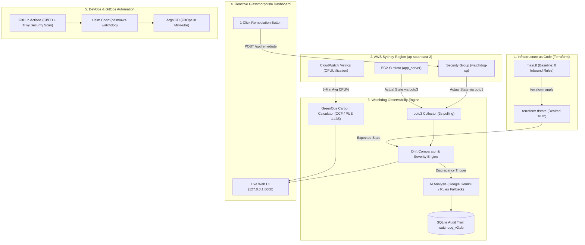

# 🛡️ AWS Infra Watchdog
### AI-Driven Drift Detection & GreenOps Monitoring for AWS

[](https://www.terraform.io/)
[](https://www.python.org/)
[](https://fastapi.tiangolo.com/)
[](https://www.docker.com/)
[](https://kubernetes.io/)
[](https://helm.sh/)
[](https://argoproj.github.io/cd/)
[-FF9900?logo=amazon-aws&logoColor=white)](https://aws.amazon.com/)

---

## 📌 Project Overview
**AWS Infra Watchdog** is an open-source, cloud-native DevOps & DevSecOps observability platform designed to solve two critical problems in modern cloud engineering:
1. **Infrastructure Drift & Security Governance:** Detecting unapproved manual alterations made in the cloud console that diverge from declared **Infrastructure-as-Code (Terraform)** baselines.
2. **GreenOps & Carbon Footprint Observability:** Real-time translation of AWS EC2 server compute utilization into scientific carbon emission rates ($\text{gCO}_2\text{e/hour}$) using the **Cloud Carbon Footprint (CCF)** methodology.

The entire system is architected for **strictly $0.00 cost** (AWS Free Tier only) and runs exclusively in the **Sydney (`ap-southeast-2`)** region.

---

## 🏗️ System Architecture



---

## 🚀 Key Features

### 1. Real-Time IaC Drift Detection
- Compares declared resources in `terraform.tfstate` against real-time AWS API queries (`describe_security_groups`, `describe_instances`).
- Evaluates rule severity:
  - **CRITICAL:** Unrestricted inbound access (`0.0.0.0/0` or `::/0`) on management ports (SSH 22, RDP 3389, or All Traffic).
  - **HIGH:** Other ports exposed to the world.
  - **MEDIUM:** Specific CIDR range divergences.

### 2. Generative AI Security Analysis
- Uses the **Google GenAI SDK** (`google-genai`) with models (`gemini-2.5-flash`, `gemini-2.0-flash`).
- When drift occurs, Gemini produces a plain-English briefing:
  - **What Happened:** Root cause of the drift.
  - **Security Risk:** Attack surface exposure and exploit vectors.
  - **Remediation Steps:** Step-by-step guidance.
- If no API key is provided, an internal deterministic rule engine acts as an instant fallback (`Rules` badge).

### 3. 1-Click Dashboard Remediation
- Operators can resolve firewall drift directly from the UI via `POST /api/remediate`.
- Invokes `boto3.revoke_security_group_ingress`, restores the zero-inbound baseline, and logs an immutable audit event in SQLite (`watchdog_v2.db`).

### 4. GreenOps Carbon Footprint Model
Calculates server carbon intensity using the scientific **Cloud Carbon Footprint** model tailored to Sydney:
$$\text{Power (Watts)} = 2 \text{ vCPUs} \times \left[0.74\text{W} + \left(\frac{\text{CPU}\%}{100}\right) \times (3.5\text{W} - 0.74\text{W})\right]$$
$$\text{Energy (kWh/hour)} = \left(\frac{\text{Power}}{1000}\right) \times 1.135 \text{ (PUE)}$$
$$\text{Carbon Emissions (gCO}_2\text{e/hour)} = \text{Energy} \times 640 \text{ gCO}_2\text{e/kWh (NSW Grid Factor)}$$

---

## 📂 Repository Structure

```text
aws-watchdog/
├── .github/
│   └── workflows/
│       └── ci.yml               # GitHub Actions CI/CD pipeline & Trivy security scanner
├── argocd/
│   └── application.yaml         # Argo CD GitOps Application manifest
├── dashboard/
│   ├── static/
│   │   ├── index.html           # Dark glassmorphism dashboard UI
│   │   ├── style.css            # Styles, 3D tilt, and animated glowing orbs
│   │   └── script.js            # 3-second live polling & Chart.js logic
│   ├── app.py                   # FastAPI backend, drift comparator, and GreenOps
│   └── watchdog_v2.db           # SQLite incident audit trail (auto-generated)
├── helm/
│   └── aws-watchdog/            # Versioned Helm Chart
│       ├── Chart.yaml
│       ├── values.yaml
│       └── templates/
│           ├── _helpers.tpl
│           ├── deployment.yaml
│           └── service.yaml
├── k8s/
│   ├── deployment.yaml          # Pure Kubernetes Deployment manifest
│   └── service.yaml             # NodePort Service manifest (port 30080)
├── terraform/
│   ├── main.tf                  # AWS provider, t3.micro, security group, and S3
│   └── terraform.tfstate        # State file (ignored in git)
├── .dockerignore                 # Protects state, secrets, and environments
├── .gitignore                   # Comprehensive secret & state protection
├── Dockerfile                   # Secure multi-stage, non-root Python container
├── requirements.txt             # Python dependencies
└── README.md                    # Project documentation
```

---

## 🛠️ Step-by-Step Execution Guide

### 1. Local Development (Virtual Environment)
```powershell
# Navigate to project and activate virtual environment
cd C:\Users\ADMIN\Desktop\aws-watchdog
.\venv\Scripts\activate

# Install dependencies
pip install -r requirements.txt

# Start dashboard server
cd dashboard
uvicorn app:app --port 8000
```
Open **`http://127.0.0.1:8000`** in your browser.

---

### 2. Deploy Infrastructure as Code (Terraform)
```powershell
cd C:\Users\ADMIN\Desktop\aws-watchdog\terraform
terraform validate
terraform apply -auto-approve
```
*The dashboard will automatically turn **Green: "Application Running"** and display your live EC2 instance ID and Sydney IP.*

---

### 3. Simulate Drift in AWS Console
1. Log in to the **AWS Console** (Region: **Sydney** / `ap-southeast-2`).
2. Go to **EC2 ➔ Security Groups ➔ `watchdog-sg`**.
3. Under **Inbound rules**, click **Edit inbound rules ➔ Add rule**:
   - **Type:** `SSH` (Port 22)
   - **Source:** `Anywhere-IPv4` (`0.0.0.0/0`)
4. Click **Save rules**.
5. Switch to Watchdog dashboard: Within 3 seconds, it flashes **RED: "Drift Detected!"** and displays the AI security analysis.

---

### 4. 1-Click Remediation & Destruction
- Click **"Remediate Now"** on the dashboard to revoke the rule.
- When finished testing, destroy all AWS resources to keep costs at **$0.00**:
```powershell
cd C:\Users\ADMIN\Desktop\aws-watchdog\terraform
terraform destroy -auto-approve
```

---

## 🐳 Containerization & Kubernetes (DevOps)

### Build Docker Container (Non-Root User)
```powershell
cd C:\Users\ADMIN\Desktop\aws-watchdog
docker build -t aws-watchdog:v1 .
```

### Deploy to Minikube using Helm
```powershell
# Start Minikube cluster
minikube start

# Deploy via Helm Chart
helm install aws-watchdog ./helm/aws-watchdog

# Expose service in browser
minikube service aws-watchdog
```

### GitOps with Argo CD
Apply the Argo CD application manifest:
```powershell
kubectl apply -f argocd/application.yaml
```
Argo CD will automatically sync changes pushed to the repository directly into your Kubernetes cluster!

---

## 🔒 DevSecOps & CI/CD Pipeline

Our `.github/workflows/ci.yml` pipeline runs automatically on every Git push:
1. **Terraform Quality & Security:** Runs `terraform fmt -check` and `terraform validate`.
2. **Python Quality:** Runs `flake8` to detect syntax errors and anti-patterns.
3. **Container Security Scanning:** Builds the Docker container and runs **Aqua Security Trivy** to scan for OS and library CVEs.
4. **Helm Validation:** Executes `helm lint` to ensure chart syntactical correctness.

---

## 📚 Scientific Citations & Methodological Notes
- **Cloud Carbon Footprint (CCF):** Open-source methodology for calculating software carbon emissions.
- **Emission Factor:** Australia National Greenhouse Accounts (NGA) Factors 2025: New South Wales (NSW) grid intensity estimated at $0.640\text{ kg CO}_2\text{e/kWh}$ ($640\text{ gCO}_2\text{e/kWh}$).
- **Power Usage Effectiveness (PUE):** Estimated at $1.135$ based on AWS modern hyperscale data center sustainability disclosures.
- **Hardware Profile:** AWS EC2 `t3.micro` powered by Intel Xeon Platinum 8000 series processors ($0.74\text{W}$ idle to $3.5\text{W}$ max per vCPU).

---

## 🎓 Academic Viva Talking Points
- **Q: Why not use AWS Config?** AWS Config is expensive (charged per rule evaluation) and operates post-facto. Watchdog operates on your exact **Terraform code baseline** in real time with zero AWS cost.
- **Q: Why is non-root execution important in Docker?** If a container running as `root` is compromised, an attacker can break out into the host kernel. Running as unprivileged user `watchdog` mitigates this risk.
- **Q: Why use Helm with Argo CD?** Helm manages template parameters, and Argo CD enforces declarative GitOps—making Git the single source of truth for deployments.
